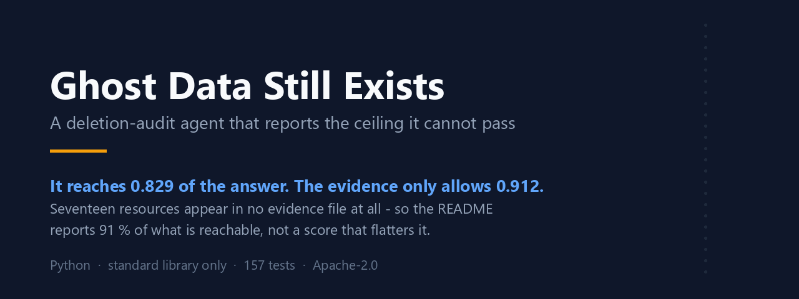

# Ghost Data Still Exists — a deletion audit agent

A person asks a company to delete their data. Months later the data is still there:
in a secondary database, a support attachment, a search index, an analytics export, a
log, a backup — or recreated by a synchronisation job that never heard about the
deletion. This agent audits one such request and decides whether the data is actually
gone: `COMPLETE`, `INCOMPLETE`, or `NOT_APPLICABLE` when no deletion was asked for in
the first place.

When data remains it produces the ordered findings, the remediation and the verification
steps. When the deletion is done it produces the evidence-backed checks that prove it.

## The number I report is not the number that flatters me

The scorer gives **0.829** per step. For a while I quoted **0.85**, counted per resource
— but the metric I report is per step, so that number flattered me, and I corrected it.

Then I measured what the data allows at all:

| | |
| --- | --- |
| 17 of 111 | resources named in the answers that appear in **no evidence file at all** |
| 17 of 193 | the steps those resources carry |
| **0.912** | so recall cannot go higher than (193 − 17) / 193 |
| **91 %** | 0.829 ÷ 0.912 — how much of the *reachable* answer the agent reaches |

Seventeen resources appear nowhere in the data. Reporting 0.829 against a ceiling of
1.000 would describe a system failing by 17 %. Reporting it against 0.912 describes a
system reaching 91 % of what the evidence permits. The second statement is the true one,
and it is the one that tells you where to spend the next day of work.

`notes/RUNS-AND-NUMBERS.md` holds every command and every figure, including the ones
that did not go my way.

## Setup

Python 3.10 or newer, and no dependency outside the standard library for the core audit
or the tests.

```bash
pip install -r requirements.txt
```

One environment variable, for the model provider — any one of these is enough:

```bash
export OPENAI_API_KEY=...      # or GROQ_API_KEY, or NEBIUS_API_KEY
```

Keys are read from the environment only. Nothing here reads a `.env`, and no key is
written to the cache, the reports or the logs.

Without a provider the run still completes and still writes a valid `output.csv`; it
simply cannot classify intent or read the screenshots, **and it says so on stdout**
instead of letting a default look like a judgement.

## Run

```bash
python code/main.py                                        # full audit
python code/main.py --case case_11                         # one case, with its plan
python -m unittest discover -s code/tests -t code          # 157 tests (81 without the dataset)
python code/evaluation/mutation_check.py                   # break the code 23 ways
```

| command | what it does |
| --- | --- |
| `python code/main.py --samples` | audit the 32 labelled cases and score them |
| `python code/main.py --no-vision` | skip the screenshot pass |
| `python code/main.py --no-intent` | skip intent classification |
| `python code/main.py --health` | write run-health signals, exit non-zero on an alert |
| `python code/evaluation/own_cases.py` | run the five evaluation cases written by hand |
| `python code/evaluation/score_intent.py` | intent classification vs the keyword baseline |
| `python code/evaluation/sweep_attribution.py` | re-derive the attribution rule by sweeping it |

The run reads its own output back off disk and checks it against the contract — row
count, column order, case ordering, status vocabulary, JSON validity, consecutive step
numbers, `[]` on every `NOT_APPLICABLE` row — and fails loudly rather than writing a file
that would be rejected.

`mutation_check.py` is the test that tests the tests: it breaks the code twenty-three
ways on purpose and checks the suite notices each one. A suite that passes a mutated
build is decoration.

## How it works

One engine, not two. `COMPLETE` is simply the case whose gap set is empty.

```
request ─▶ intent        does this authorise deletion?  no ─▶ NOT_APPLICABLE, []
              │ yes
              ▼
           identity      email, current OR historical ─▶ the subject, and every
              │                                          identifier ever attached to them
              ▼
           evidence      every evidence file, parsed once into one Observation shape
              │
              ▼
           inventory     which resources belong to this subject, as known at audit_at
              │
              ▼
           policy        rules     ─▶ required end state per resource
              │          evidence  ─▶ observed state at audit_at
              ▼
           gap           required vs observed
              │            ├─ empty     ─▶ COMPLETE   : verification only, each cited
              │            └─ non-empty ─▶ INCOMPLETE : findings, remediation, verification
              ▼
           serialise     mechanical ordering, consecutive numbering, CSV
```

`ARCHITECTURE.md` says the same in plain English, with a one-line description of every
file.

## What is deliberately not in this repository

This was written for the **HackerRank Orchestrate** challenge of October 2026. The
problem statement, the evaluation dataset and the organisers' `AGENTS.md` belong to
HackerRank, not to me, so they are not republished here. What that means for you:

- `python code/main.py` needs a `dataset/` directory it will not find in this clone. A
  full end-to-end run is therefore not reproducible here, though all the code, the tests
  and the evaluation harness are present and readable.
- **The test suite is 157 tests with the dataset in place.** In this clone it collects
  **81** and **13 of them error out** on a missing `dataset/` — the adversarial tests load
  the real evidence files on purpose, because fixtures cannot reproduce a malformed
  snapshot someone actually shipped. The remaining 68 build their own fixtures and pass:

  ```
  Ran 81 tests in 11s
  FAILED (errors=13)        # all 13: FileNotFoundError: dataset directory not found
  ```

  I would rather print that output here than claim a green suite you cannot get.

## The decision journal

`notes/JOURNAL-DECISIONS.md` is the log I kept *during* the sprint, in French — one entry
per non-obvious choice, three lines each: what I chose, what I rejected and why, and the
figure that settles it. A choice with no rejected alternative is not a choice, it is a
reflex; a choice with no figure cannot be defended. Where I had not measured, the entry
says **"pas mesuré"** rather than inventing a certainty.

It is the part of this repository I would read first.

## Licence

Apache-2.0. See `LICENSE`.
